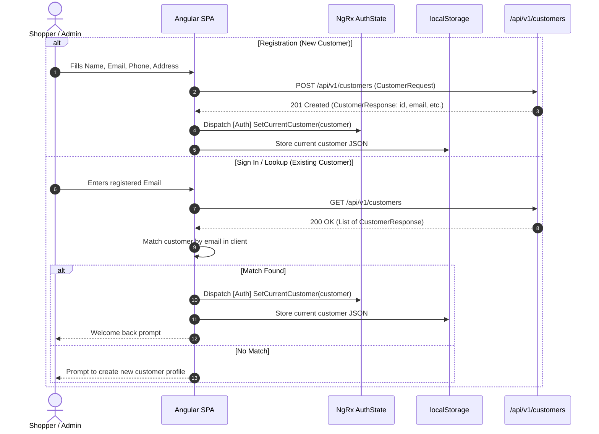
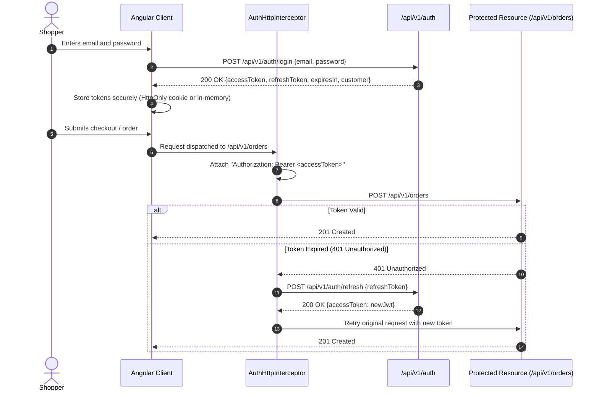

# Authentication & Authorization Specification

## 1. Codebase Reality Assessment

A rigorous audit of the `ecommerce-api` source code reveals that **Authentication and Authorization are currently NOT implemented in the backend**.

Specifically:
- **No Spring Security Dependency**: `spring-boot-starter-security` is absent from `pom.xml`.
- **No Security Filter Chain**: No servlet filters, interceptors, or security configurations exist.
- **No Password Field**: The `Customer` entity (`Customer.java`) stores `first_name`, `last_name`, `email`, `phone`, `address`, and `created_at`. It has **no password hash or salt field**.
- **No Auth Endpoints**: There are no `/api/v1/auth/login`, `/api/v1/auth/register`, `/api/v1/auth/refresh`, or `/api/v1/auth/logout` endpoints.
- **No Roles or Permissions**: There is no concept of `ROLE_ADMIN` vs `ROLE_CUSTOMER` in the data layer. All 25 REST endpoints are publicly accessible without headers.
- **Residual Code**: An `AccessDeniedException` class exists in `com.ecom.api.exception` and is handled in `GlobalExceptionHandler` (returning HTTP 403), but no service method currently throws it.

---

## 2. Current Architecture vs. Production Target Architecture

To enable immediate Angular frontend development while planning for enterprise security, this document outlines two models:
1. **Interim Architecture (Current Backend Parity)**: How Angular manages customer identity against the existing backend.
2. **Target Architecture (Production Roadmap)**: Standard JWT-based Spring Security implementation to be added to the backend.

---

## 3. Interim Architecture: Client-Side Identity Management

Because the backend operates on a customer identity model without passwords, the Angular application must manage session context using customer email and ID.

### 3.1 Customer Identification & Registration Flow



### 3.2 Interim Session State in Angular

```typescript
// Interim Auth State Model in Angular
export interface AuthState {
  currentCustomer: CustomerResponse | null;
  isAuthenticated: boolean;
  isAdminMode: boolean; // Client-side toggle for catalog management views
  guestCheckout: boolean;
}
```

---

## 4. Target Production Architecture: Spring Security & JWT

When Spring Security is added to the backend, the system will use stateless JWT Bearer token authentication.

### 4.1 Target Authentication Flow



### 4.2 Recommended Target Token Specifications

- **Token Type**: JWT (JSON Web Token), RFC 7519
- **Signature Algorithm**: HMAC-SHA256 (`HS256`) or RSA (`RS256`)
- **Token Claims**:
  ```json
  {
    "sub": "customer_id_or_email",
    "roles": ["ROLE_CUSTOMER"],
    "email": "john.doe@example.com",
    "iat": 1732185600,
    "exp": 1732189200
  }
  ```
- **Access Token Lifetime**: 15–30 minutes
- **Refresh Token Lifetime**: 7–30 days (stored in HTTP-Only, Secure, SameSite cookie)
- **Header Convention**: `Authorization: Bearer <token>`

---

## 5. Angular Client Implementation Blueprint

To avoid rewriting Angular components when backend security is deployed, build the Angular HTTP and Auth layers to support tokens immediately:

### 5.1 Token Storage Strategy
1. **Access Token**: Maintain in NgRx state / memory.
2. **Persistence**: In `localStorage` under `ecom_auth_session` for development; transition to HttpOnly cookies or encrypted web storage in production.

### 5.2 Angular HTTP Interceptor (`auth.interceptor.ts`)

```typescript
import { Injectable } from '@angular/core';
import {
  HttpRequest,
  HttpHandler,
  HttpEvent,
  HttpInterceptor,
  HttpErrorResponse
} from '@angular/common/http';
import { Observable, throwError } from 'rxjs';
import { catchError } from 'rxjs/operators';
import { Router } from '@angular/router';

@Injectable()
export class AuthInterceptor implements HttpInterceptor {

  constructor(private router: Router) {}

  intercept(request: HttpRequest<unknown>, next: HttpHandler): Observable<HttpEvent<unknown>> {
    const token = localStorage.getItem('ecom_access_token');
    
    let authReq = request;
    if (token) {
      authReq = request.clone({
        setHeaders: {
          Authorization: `Bearer ${token}`
        }
      });
    }

    return next.handle(authReq).pipe(
      catchError((error: HttpErrorResponse) => {
        if (error.status === 401) {
          // Token expired or invalid: redirect to login
          this.router.navigate(['/auth/login'], {
            queryParams: { returnUrl: this.router.url }
          });
        } else if (error.status === 403) {
          // Forbidden: user lacks required role
          this.router.navigate(['/forbidden']);
        }
        return throwError(() => error);
      })
    );
  }
}
```

### 5.3 Angular Route Guards
1. **`AuthGuard`**: Protects customer order history, checkout, and profile screens by verifying `currentCustomer !== null`.
2. **`AdminGuard`**: Protects category and product creation/edit screens. In the interim, this checks a client-side administrator flag or dedicated route.

---

## 6. Access Control Matrix (Target State)

| Endpoint Category | Endpoints | Public / Guest | Customer | Admin |
| :--- | :--- | :---: | :---: | :---: |
| **Catalog Browsing** | `GET /api/v1/categories/**`, `GET /api/v1/products/**` | **Read** | **Read** | **Read** |
| **Catalog Management** | `POST/PUT/DELETE /api/v1/categories/**`, `POST/PUT/DELETE /api/v1/products/**` | Denied | Denied | **Full CRUD** |
| **Customer Registration**| `POST /api/v1/customers` | **Create** | **Create** | **Full CRUD** |
| **Customer Profile** | `GET/PUT /api/v1/customers/{id}` | Denied | **Own ID Only** | **Full CRUD** |
| **Order Placement** | `POST /api/v1/orders` | **Guest (if email provided)** | **Create** | **Create** |
| **Order History** | `GET /api/v1/orders?customerId={id}` | Denied | **Own Orders Only** | **View All** |
| **Order Management** | `PUT /api/v1/orders/{id}/status` | Denied | Denied | **Update Status** |
| **Order Cancellation**| `PUT /api/v1/orders/{id}/cancel` | Denied | **Own Orders (if PENDING)**| **Cancel Any** |
| **Payment Status** | `GET/PUT /api/v1/payments/**` | Denied | **View Own Order** | **Full Control** |
