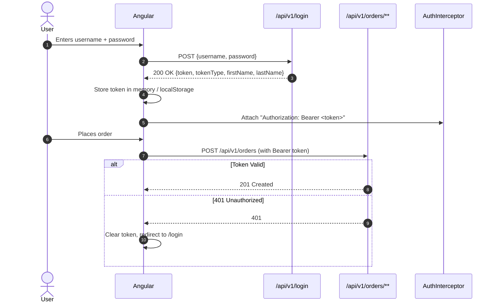

# Authentication & Authorization Specification

## 1. Current Backend Security Implementation (As of commit 374815b)

The `ecommerce-api` now implements **stateless JWT-based authentication** using Spring Security 6.x. This is the production-ready architecture — no interim workaround is needed.

### 1.1 Security Stack
- **Framework**: Spring Boot Starter Security (`spring-boot-starter-security`)
- **Token Standard**: JWT (RFC 7519) via `jjwt-api` / `jjwt-impl` / `jjwt-jackson` 0.12.6
- **Password Hashing**: BCrypt (`BCryptPasswordEncoder`, cost factor 10)
- **Session Policy**: `STATELESS` — no server-side sessions, tokens self-contained
- **CORS**: Configured for `http://localhost:4200` with credentials support

### 1.2 Protected vs. Public Endpoints

| Access Level | Endpoints |
| :--- | :--- |
| **Public (Permit All)** | `GET /api/v1/categories/**`, `GET /api/v1/products/**`, `POST /api/v1/customers`, `GET /api/v1/customers`, `GET /api/v1/customers/{id}`, `PUT /api/v1/customers/{id}`, `DELETE /api/v1/customers/{id}`, `POST /api/v1/auth/login`, `POST /api/v1/auth/signup`, `POST /api/v1/login`, `POST /api/v1/signup` |
| **Authenticated (JWT Required)** | `POST /api/v1/orders`, `GET /api/v1/orders`, `GET /api/v1/orders/{id}`, `GET /api/v1/orders/number/{orderNumber}`, `PUT /api/v1/orders/{id}/status`, `PUT /api/v1/orders/{id}/cancel`, `GET /api/v1/payments/order/{orderId}`, `PUT /api/v1/payments/order/{orderId}/status`, `POST/PUT/DELETE /api/v1/categories/**`, `POST/PUT/DELETE /api/v1/products/**` |

> **Note**: Order and Payment endpoints require authentication. Catalog write endpoints (Categories, Products) also require authentication but currently have no role-based distinction — any authenticated user can invoke them.

---

## 2. Authentication Endpoints

### 2.1 User Login
**Endpoint**: `POST /api/v1/login` (also aliased as `/api/v1/auth/login`)

**Request**:
```json
{
  "username": "partha.chakra2",
  "password": "admin123"
}
```

**Response (200 OK)**:
```json
{
  "token": "eyJhbGciOiJIUzI1NiJ9...",
  "tokenType": "Bearer",
  "firstName": "Partha",
  "lastName": "Chakraborty"
}
```

**Error Responses**:
- `400 Bad Request` — Validation errors (missing username/password)
- `401 Unauthorized` — Invalid credentials

### 2.2 User Registration
**Endpoint**: `POST /api/v1/signup` (also aliased as `/api/v1/auth/signup`)

**Request**:
```json
{
  "firstName": "Partha",
  "lastName": "Chakraborty",
  "username": "partha.chakra2",
  "password": "admin123"
}
```

**Response (200 OK)**:
```json
{
  "status": 200,
  "message": "Registration successful"
}
```

**Error Responses**:
- `400 Bad Request` — Validation errors (field constraints)
- `409 Conflict` — Username already exists

---

## 3. JWT Token Specification

| Property | Value |
| :--- | :--- |
| **Algorithm** | HMAC-SHA256 (`HS256`) |
| **Secret** | Configurable via `jwt.secret` (default: 64-char base64 in `application.properties`) |
| **Expiration** | 24 hours (`86400000 ms`, configurable via `jwt.expiration`) |
| **Subject (`sub`)** | Username (unique) |
| **Claims** | `username`, `iat`, `exp` |
| **Header** | `Authorization: Bearer <token>` |
| **Token Type in Response** | `"Bearer"` |

### 3.1 Token Payload Example (Decoded)
```json
{
  "sub": "partha.chakra2",
  "iat": 1732185600,
  "exp": 1732272000
}
```

---

## 4. User & Authority Model

### 4.1 Database Entity: `users` Table
```sql
CREATE TABLE users (
    id         BIGINT        NOT NULL AUTO_INCREMENT,
    first_name VARCHAR(100)  NOT NULL,
    last_name  VARCHAR(100)  NOT NULL,
    username   VARCHAR(100)  NOT NULL UNIQUE,
    password   VARCHAR(255)  NOT NULL,  -- BCrypt hash
    created_at DATETIME,
    updated_at DATETIME,
    PRIMARY KEY (id),
    UNIQUE KEY uk_users_username (username)
);
```

### 4.2 Current Role Model
- **Single Role**: `ROLE_USER` assigned to every user via `UserPrincipal.create()`
- **No Admin Role Yet**: All authenticated users have identical permissions
- **Customer vs User**: `Customer` entity (orders, shipping) is separate from `User` entity (authentication). Linking them is a future enhancement.

---

## 5. Spring Security Configuration Details

### 5.1 Filter Chain (`SecurityConfig.java`)
- CSRF: **Disabled** (stateless JWT)
- Session: `STATELESS`
- Entry Point: `JwtAuthenticationEntryPoint` → returns `401` with JSON error
- Filter: `JwtAuthenticationFilter` extracts `Authorization` header, validates token, sets `SecurityContext`
- CORS: `CorsConfigurationSource` allowing `http://localhost:4200`, credentials, `Authorization` header exposed

### 5.2 Authorization Rules
```java
.authorizeHttpRequests(auth -> auth
    .requestMatchers("/api/v1/orders/**", "/api/v1/payments/**").authenticated()
    .anyRequest().permitAll()
)
```
> **Current Gap**: Category/Product write endpoints are under `.anyRequest().permitAll()` — they should be protected.

### 5.3 Password Encoding
```java
@Bean
public PasswordEncoder passwordEncoder() {
    return new BCryptPasswordEncoder(); // Cost factor 10
}
```

---

## 6. Angular Client Integration Guide

### 6.1 Login Flow


### 6.2 Required Angular HTTP Interceptor (`auth.interceptor.ts`)

```typescript
import { Injectable } from '@angular/core';
import { HttpRequest, HttpHandler, HttpEvent, HttpInterceptor, HttpErrorResponse } from '@angular/common/http';
import { Observable, throwError, BehaviorSubject } from 'rxjs';
import { catchError, filter, take, switchMap } from 'rxjs/operators';
import { Router } from '@angular/router';
import { AuthService } from './auth.service';

@Injectable()
export class AuthInterceptor implements HttpInterceptor {

  private isRefreshing = false;
  private refreshTokenSubject: BehaviorSubject<string | null> = new BehaviorSubject<string | null>(null);

  constructor(private authService: AuthService, private router: Router) {}

  intercept(request: HttpRequest<unknown>, next: HttpHandler): Observable<HttpEvent<unknown>> {
    const token = this.authService.getAccessToken();

    let authReq = request;
    if (token) {
      authReq = this.addTokenHeader(request, token);
    }

    return next.handle(authReq).pipe(
      catchError((error: HttpErrorResponse) => {
        if (error.status === 401 && !authReq.url.includes('/login') && !authReq.url.includes('/signup')) {
          return this.handle401Error(authReq, next);
        }
        return throwError(() => error);
      })
    );
  }

  private addTokenHeader(request: HttpRequest<unknown>, token: string): HttpRequest<unknown> {
    return request.clone({
      setHeaders: {
        Authorization: `Bearer ${token}`
      }
    });
  }

  private handle401Error(request: HttpRequest<unknown>, next: HttpHandler): Observable<HttpEvent<unknown>> {
    if (!this.isRefreshing) {
      this.isRefreshing = true;
      this.refreshTokenSubject.next(null);

      return this.authService.refreshToken().pipe(
        switchMap((newToken: string) => {
          this.isRefreshing = false;
          this.refreshTokenSubject.next(newToken);
          return next.handle(this.addTokenHeader(request, newToken));
        }),
        catchError((err) => {
          this.isRefreshing = false;
          this.authService.logout();
          this.router.navigate(['/login']);
          return throwError(() => err);
        })
      );
    }

    return this.refreshTokenSubject.pipe(
      filter(token => token !== null),
      take(1),
      switchMap(token => next.handle(this.addTokenHeader(request, token!)))
    );
  }
}
```

### 6.3 Angular AuthService (`auth.service.ts`)

```typescript
import { Injectable } from '@angular/core';
import { HttpClient } from '@angular/common/http';
import { BehaviorSubject, Observable, tap } from 'rxjs';
import { Router } from '@angular/router';

export interface LoginRequest {
  username: string;
  password: string;
}

export interface SignupRequest {
  firstName: string;
  lastName: string;
  username: string;
  password: string;
}

export interface AuthResponse {
  token: string;
  tokenType: string;
  firstName: string;
  lastName: string;
}

export interface SignupResponse {
  status: number;
  message: string;
}

export interface UserProfile {
  firstName: string;
  lastName: string;
  username: string;
}

@Injectable({ providedIn: 'root' })
export class AuthService {
  private readonly API_URL = '/api/v1';
  private currentUserSubject = new BehaviorSubject<UserProfile | null>(null);
  public currentUser$ = this.currentUserSubject.asObservable();

  constructor(private http: HttpClient, private router: Router) {
    this.loadStoredAuth();
  }

  login(request: LoginRequest): Observable<AuthResponse> {
    return this.http.post<AuthResponse>(`${this.API_URL}/login`, request).pipe(
      tap(response => this.setSession(response))
    );
  }

  signup(request: SignupRequest): Observable<SignupResponse> {
    return this.http.post<SignupResponse>(`${this.API_URL}/signup`, request);
  }

  refreshToken(): Observable<string> {
    // Backend currently issues new token on login; implement refresh endpoint when available
    // For now, force re-login
    this.logout();
    return new Observable(observer => observer.error('Session expired'));
  }

  logout(): void {
    localStorage.removeItem('ecom_access_token');
    localStorage.removeItem('ecom_user_profile');
    this.currentUserSubject.next(null);
    this.router.navigate(['/login']);
  }

  getAccessToken(): string | null {
    return localStorage.getItem('ecom_access_token');
  }

  isAuthenticated(): boolean {
    return !!this.getAccessToken();
  }

  private setSession(response: AuthResponse): void {
    localStorage.setItem('ecom_access_token', response.token);
    const profile: UserProfile = {
      firstName: response.firstName,
      lastName: response.lastName,
      username: '' // Not returned by login; fetch if needed
    };
    localStorage.setItem('ecom_user_profile', JSON.stringify(profile));
    this.currentUserSubject.next(profile);
  }

  private loadStoredAuth(): void {
    const stored = localStorage.getItem('ecom_user_profile');
    if (stored) {
      this.currentUserSubject.next(JSON.parse(stored));
    }
  }
}
```

### 6.4 Route Guards

```typescript
// auth.guard.ts
import { Injectable } from '@angular/core';
import { CanActivate, Router } from '@angular/router';
import { AuthService } from './auth.service';

@Injectable({ providedIn: 'root' })
export class AuthGuard implements CanActivate {
  constructor(private auth: AuthService, private router: Router) {}

  canActivate(): boolean {
    if (this.auth.isAuthenticated()) {
      return true;
    }
    this.router.navigate(['/login'], { queryParams: { returnUrl: this.router.url } });
    return false;
  }
}
```

```typescript
// guest.guard.ts (for login/signup pages)
import { Injectable } from '@angular/core';
import { CanActivate, Router } from '@angular/router';
import { AuthService } from './auth.service';

@Injectable({ providedIn: 'root' })
export class GuestGuard implements CanActivate {
  constructor(private auth: AuthService, private router: Router) {}

  canActivate(): boolean {
    if (!this.auth.isAuthenticated()) {
      return true;
    }
    this.router.navigate(['/']);
    return false;
  }
}
```

---

## 7. CORS Configuration

The backend explicitly allows the Angular dev server:

```java
@Bean
public CorsConfigurationSource corsConfigurationSource() {
    CorsConfiguration configuration = new CorsConfiguration();
    configuration.setAllowedOrigins(List.of("http://localhost:4200"));
    configuration.setAllowedMethods(List.of("GET", "POST", "PUT", "DELETE", "OPTIONS", "PATCH"));
    configuration.setAllowedHeaders(List.of("*"));
    configuration.setExposedHeaders(List.of("Authorization"));
    configuration.setAllowCredentials(true);
    configuration.setMaxAge(3600L);

    UrlBasedCorsConfigurationSource source = new UrlBasedCorsConfigurationSource();
    source.registerCorsConfiguration("/**", configuration);
    return source;
}
```

**Angular `proxy.conf.json`** (for development, if not using direct CORS):
```json
{
  "/api": {
    "target": "http://localhost:8080",
    "secure": false,
    "changeOrigin": true
  }
}
```

---

## 8. Current Security Gaps & Recommended Enhancements

| Gap | Severity | Recommendation |
| :--- | :---: | :--- |
| **No Refresh Token Endpoint** | High | Add `/api/v1/auth/refresh` returning new access token; store refresh token in HttpOnly cookie |
| **Single Role (`ROLE_USER`)** | Medium | Add `ROLE_ADMIN`; protect catalog write endpoints with `@PreAuthorize("hasRole('ADMIN')")` |
| **User-Customer Link Missing** | Medium | Add `user_id` FK to `customers` table; associate orders with authenticated user |
| **Catalog Write Endpoints Unprotected** | High | Move `POST/PUT/DELETE /api/v1/categories/**`, `POST/PUT/DELETE /api/v1/products/**` under `.authenticated()` or role-based rules |
| **Password Policy** | Low | Enforce complexity (uppercase, digit, special char) via `@Pattern` on `SignupRequest.password` |
| **Rate Limiting on Auth** | Medium | Add bucket4j or Spring Cloud Gateway rate limiting on `/login`, `/signup` |
| **Token Revocation / Blacklist** | Medium | Implement Redis-based blocklist for logout / compromised tokens |
| **Secure Headers** | Low | Add `Content-Security-Policy`, `X-Frame-Options`, `Referrer-Policy` via `SecurityFilterChain` |

---

## 9. Testing the Auth Flow

### 9.1 Via Swagger UI
1. Start backend: `./mvnw spring-boot:run`
2. Open `http://localhost:8080/swagger-ui/index.html`
3. `POST /api/v1/login` with:
   ```json
   { "username": "partha.chakra2", "password": "admin123" }
   ```
4. Copy `token` from response
5. Click **Authorize** (🔒) → paste `Bearer <token>`
6. Call protected endpoints (e.g., `POST /api/v1/orders`)

### 9.2 Via cURL
```bash
# Login
TOKEN=$(curl -s -X POST http://localhost:8080/api/v1/login \
  -H "Content-Type: application/json" \
  -d '{"username":"partha.chakra2","password":"admin123"}' | jq -r .token)

# Call protected endpoint
curl -X GET http://localhost:8080/api/v1/orders \
  -H "Authorization: Bearer $TOKEN"
```

---

## 10. Summary: Angular Implementation Checklist

- [ ] `AuthService` with `login()`, `signup()`, `logout()`, `getAccessToken()`, `isAuthenticated()`
- [ ] `AuthInterceptor` attaching `Authorization: Bearer <token>` header
- [ ] 401 handling → redirect to `/login` with `returnUrl`
- [ ] `AuthGuard` protecting `/checkout`, `/account/**`, `/orders/**`
- [ ] `GuestGuard` protecting `/login`, `/signup`
- [ ] Token persisted in `localStorage` (dev) / HttpOnly cookie (prod)
- [ ] NgRx `auth` slice: `token`, `user`, `isAuthenticated`
- [ ] Login / Signup forms with validation matching backend DTOs
- [ ] Header showing user name / logout when authenticated