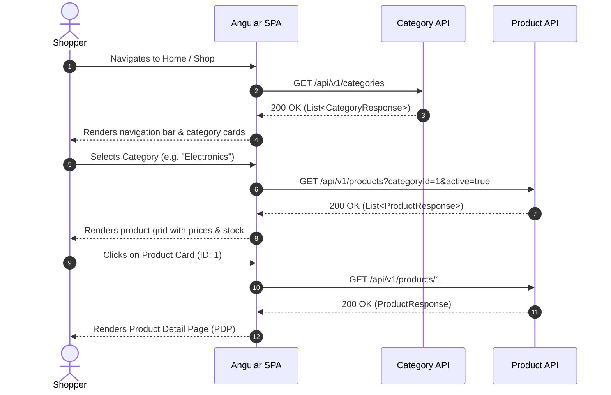
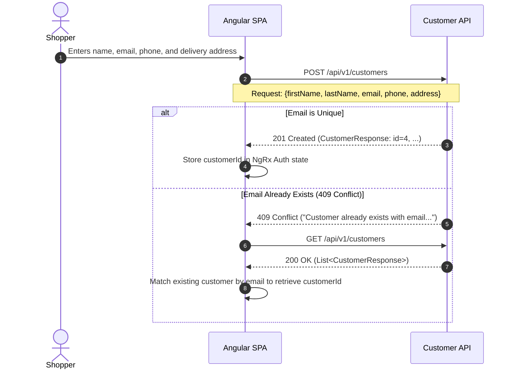
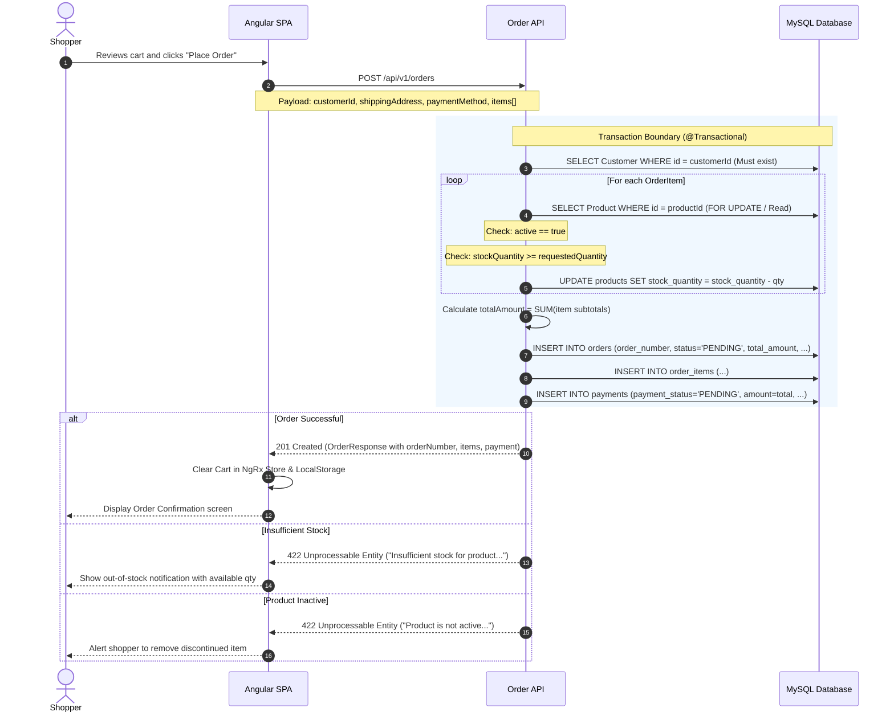
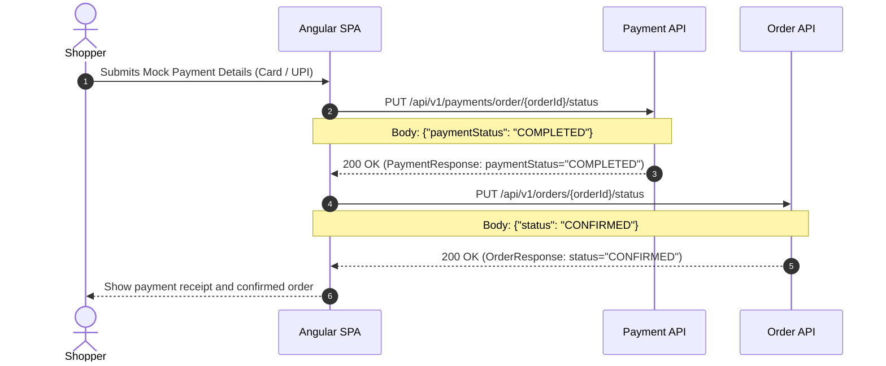
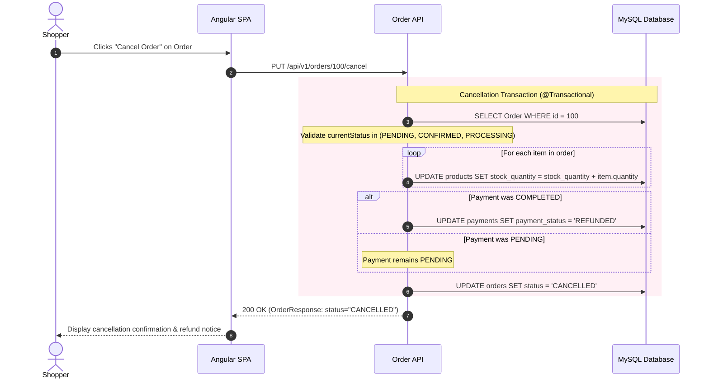
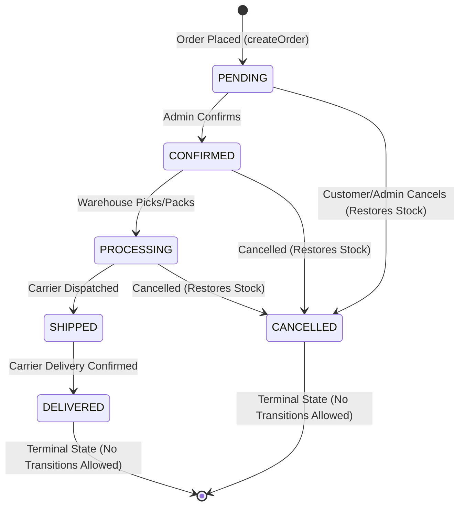

# End-to-End Business Workflows

## 1. Overview

This document specifies the end-to-end business workflows supported by the `ecommerce-api` backend, detailing the exact sequence of HTTP requests, payload structures, business rule validations, database state changes, and error conditions.

Workflows are categorized into:
- **Implemented Workflows**: Fully executable against the current backend.
- **Client-Assisted Workflows**: Partially supported; requires Angular client-side state (e.g. cart, search).
- **Missing Workflows**: Not supported by backend APIs (e.g. coupons, reviews).

---

## 2. Customer Workflows

### 2.1 Customer Catalog Browsing & Product Discovery
*Status: **FULLY IMPLEMENTED***

Allows shoppers to browse available categories, view catalog listings, and inspect individual product details.

- **Backend Rules**:
  - Inactive products (`active = false`) can be excluded using query parameter `active=true`.
- **Database Operations**:
  - `SELECT * FROM categories;`
  - `SELECT * FROM products WHERE category_id = 1 AND active = TRUE;`
  - `SELECT * FROM products WHERE id = 1;`
- **Failure Scenarios**:
  - Invalid Category ID: Returns empty product array (`[]`).
  - Product Not Found: Returns `404 Not Found`.

---

### 2.2 Shopping Cart & Wishlist Management
*Status: **CLIENT-SIDE ONLY (BACKEND MISSING)***

The backend has no `/api/v1/cart` or `/api/v1/wishlist` endpoints. 

**Angular Implementation Requirement**:
- The Angular application must manage cart state using **NgRx Store** and synchronize it with browser `localStorage`.
- When the user adds an item to cart:
  - Angular records `productId`, `name`, `price`, `sku`, and selected `quantity`.
  - Client validates that selected `quantity <= product.stockQuantity`.
- Wishlist items are saved in client storage as an array of product IDs.

---

### 2.3 Customer Identification (Guest / Registration)
*Status: **IMPLEMENTED VIA CUSTOMER CRUD***

Before checkout, the shopper's identity (`customerId`) must be established.

---

### 2.4 Checkout & Order Placement
*Status: **FULLY IMPLEMENTED***

This is the central transactional workflow of the system.

- **Backend Business Rules Executed**:
  1. Customer existence validated.
  2. Each product must exist, be active (`active == true`), and have sufficient stock.
  3. Product stock is decremented immediately in the database.
  4. Unique order number generated: format `ORD-` followed by 8 uppercase alphanumeric characters.
  5. 1:1 `Payment` record initialized with status `PENDING`.
- **Database Changes**:
  - `products.stock_quantity` decremented.
  - New row in `orders`.
  - Multiple rows in `order_items`.
  - New row in `payments`.

---

### 2.5 Payment Completion Simulation
*Status: **FULLY IMPLEMENTED***

Since no third-party payment gateway is integrated into the backend, the payment status is updated via API to complete the financial step.

---

### 2.6 Order Tracking & History
*Status: **FULLY IMPLEMENTED***

Shoppers can monitor their orders in real-time.

1. **Customer Order History**:
   - `GET /api/v1/orders?customerId={customerId}`
   - Returns all historical orders placed by this customer, including item breakdowns and current status.
2. **Track Single Order by Order Number**:
   - `GET /api/v1/orders/number/{orderNumber}`
   - Useful for tracking orders without customer login (guest tracking).

---

### 2.7 Order Cancellation & Stock Compensation
*Status: **FULLY IMPLEMENTED***

Shoppers can cancel an order that has not yet shipped.

- **Backend Rules**:
  - Allowed prior states: `PENDING`, `CONFIRMED`, `PROCESSING`.
  - Disallowed states: `DELIVERED`, `CANCELLED` (returns `422 Unprocessable Entity`).
  - Stock is fully restored to the `products` table for every line item.
  - Completed payments are automatically marked `REFUNDED`.

---

## 3. Administrative Workflows

### 3.1 Catalog Management (Categories & Products)
*Status: **FULLY IMPLEMENTED***

1. **Category Maintenance**:
   - Create: `POST /api/v1/categories` (Enforces unique name & slug).
   - Update: `PUT /api/v1/categories/{id}`.
   - Delete: `DELETE /api/v1/categories/{id}`.
2. **Product Catalog Maintenance**:
   - Create Product: `POST /api/v1/products` (Enforces unique SKU, category link).
   - Update Product & Stock: `PUT /api/v1/products/{id}`.
   - Toggle Visibility: `PUT /api/v1/products/{id}` with `active: false`.
   - Delete Product: `DELETE /api/v1/products/{id}`.

---

### 3.2 Order Lifecycle Fulfillment
*Status: **FULLY IMPLEMENTED***

Warehouse or fulfillment staff transition orders through the one-way state machine.

**API Execution**:
- `PUT /api/v1/orders/{id}/status`
- Payload: `{"status": "CONFIRMED"}` (then `PROCESSING`, then `SHIPPED`, then `DELIVERED`).
- If an admin attempts an illegal transition (e.g. `PENDING` -> `DELIVERED` or `DELIVERED` -> `CANCELLED`), the backend rejects it with `422 Unprocessable Entity`:
  `"Cannot transition order status from DELIVERED to CANCELLED"`.

---

## 4. Missing Business Workflows (Not Implemented in Backend)

The following workflows cannot be executed against the backend without code modifications:
1. **User Authentication & Session Management**: No login/logout, password reset, or token refresh.
2. **Persistent Cart / Wishlist Synchronization**: Cart data cannot be persisted across devices.
3. **Discount Codes & Coupons**: No coupon validation or discount calculation.
4. **Product Reviews & Star Ratings**: No review submission or rating calculation.
5. **Multi-Address Book**: Customers cannot save multiple shipping or billing addresses.
6. **Carrier Shipping Rate Calculation**: Flat or free shipping only; no real-time carrier rates.
