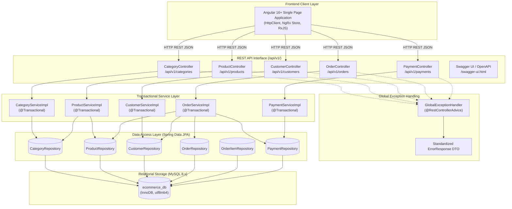

# Project Overview & Architecture: E-Commerce Backend (`ecommerce-api`)

## 1. Executive Summary

The `ecommerce-api` is a modular, monolithic RESTful backend built on the Java and Spring Boot ecosystem. It provides core e-commerce capabilities covering category taxonomy, product catalog management, customer records, order lifecycle orchestration, and payment state tracking.

This document serves as the architectural baseline for developing an independent, modern Angular frontend. It details the actual technical stack, internal layer interactions, data flow, external boundaries, and architectural constraints discovered through source code inspection.

---

## 2. Technology Stack & Runtime Specifications

| Component | Technology / Specification | Verified In Codebase |
| :--- | :--- | :--- |
| **Language Runtime** | Java 17 | `pom.xml` (`<java.version>17</java.version>`) |
| **Framework** | Spring Boot 4.1.2 | `pom.xml` (`spring-boot-starter-parent` 4.1.2) |
| **Web MVC Layer** | Spring Web MVC | `spring-boot-starter-webmvc` |
| **Data Access / ORM** | Spring Data JPA / Hibernate 6.x | `spring-boot-starter-data-jpa` |
| **Database** | MySQL 8.x | `mysql-connector-j`, `ecommerce_db` |
| **Schema Management** | Validated DDL via SQL script | `schema.sql`, `ddl-auto=validate` |
| **API Documentation** | OpenAPI 3.0 / Swagger UI | `springdoc-openapi-starter-webmvc-ui` v3.0.0 |
| **Validation Framework** | Jakarta Bean Validation (Hibernate Validator) | `spring-boot-starter-validation` |
| **Boilerplate Reduction** | Project Lombok | Lombok annotations (`@Getter`, `@Setter`, `@Builder`, `@RequiredArgsConstructor`) |
| **Build Tool** | Apache Maven (with Maven Wrapper `mvnw`) | `pom.xml`, `.mvn/wrapper/` |
| **Security Layer** | **None** (`spring-boot-starter-security` NOT present) | Codebase inspection of `pom.xml` & config |
| **External Payment Gateway** | **None** (Status tracked via internal DB state) | `PaymentServiceImpl.java` |
| **Cloud File Storage** | **None** (No S3/Cloudinary/Multipart endpoints) | Codebase inspection |

---

## 3. Core Architectural Principles

The application adheres to clean separation of concerns and layered architecture guidelines:

1. **Layered Architecture**:
   - **Controller Layer** (`com.ecom.api.controller`): Thin HTTP presentation layer exposing REST APIs under `/api/v1/`. Strictly consumes and produces Data Transfer Objects (DTOs). No business logic.
   - **Service Layer** (`com.ecom.api.service`): Transactional business logic layer with explicit interface-implementation separation (`Service` interface and `ServiceImpl`). Enforces state machine transitions, stock reservations, and cross-entity orchestration.
   - **Repository Layer** (`com.ecom.api.repository`): Spring Data JPA repositories extending `JpaRepository<Entity, Long>` providing declarative and derived query methods.
   - **Entity / Domain Layer** (`com.ecom.api.entity`): Relational mapping using Jakarta Persistence annotations. Enforces domain invariants (`@PrePersist`, `@PreUpdate`, lifecycle calculations).
   - **Exception Layer** (`com.ecom.api.exception`): Centralized exception handling via `@RestControllerAdvice` generating standardized `ErrorResponse` payloads.

2. **DTO-Entity Isolation**:
   - Entities are never exposed over the wire.
   - Request DTOs enforce field-level constraints (`@NotBlank`, `@NotNull`, `@Min`, `@DecimalMin`, `@Size`, `@Email`).
   - Response DTOs shield internal entity relationships and prevent JSON infinite recursion.

3. **Strict Database-First Schema Enforcement**:
   - Hibernate's schema auto-generation is disabled (`spring.jpa.hibernate.ddl-auto=validate`).
   - The authoritative database schema is maintained in `db/schema.sql`.

4. **Zero-Session REST Design**:
   - Controllers are stateless. `Open-In-View` is disabled (`spring.jpa.open-in-view=false`) to prevent lazy loading issues outside transaction boundaries.

---

## 4. Backend Architecture Diagram

---

## 5. Application Modules & Responsibilities

The codebase consists of five distinct functional domains:

### 5.1 Category Management Module
- **Entities**: `Category`
- **Responsibilities**:
  - Maintains product categorization hierarchy.
  - Enforces uniqueness on category `name` and URL-friendly `slug`.
  - Supports lookup by primary key ID and by unique slug.
  - Provides full CRUD operations for administrative catalog organization.

### 5.2 Product Catalog Module
- **Entities**: `Product`
- **Responsibilities**:
  - Manages SKU-based inventory items linked to a parent category.
  - Enforces unique SKU format across the catalog.
  - Controls product visibility via boolean `active` status flag.
  - Tracks unit prices (`BigDecimal` with scale 2) and stock quantities.
  - Provides query filtering by `categoryId` and `active` status.

### 5.3 Customer Management Module
- **Entities**: `Customer`
- **Responsibilities**:
  - Manages customer identities (first name, last name, unique email, phone, default address).
  - Acts as the parent reference for orders.
  - Note: In the current implementation, this serves as a customer directory rather than an authenticated user registry (see Authentication section).

### 5.4 Order Orchestration Module
- **Entities**: `Order`, `OrderItem`
- **Responsibilities**:
  - Validates and executes customer order placements.
  - Generates unique order reference numbers (`ORD-XXXXXXXX`).
  - **Stock Management Invariant**: Automatically deducts product stock during order placement and throws `BusinessRuleException` (422) if inventory is insufficient or products are inactive.
  - **State Machine Engine**: Enforces strict, one-way order lifecycle transitions (`PENDING` -> `CONFIRMED` -> `PROCESSING` -> `SHIPPED` -> `DELIVERED`).
  - **Cancellation & Compensation**: Cancelling an order restores product stock to the inventory and marks completed payments as `REFUNDED`.

### 5.5 Payment Tracking Module
- **Entities**: `Payment`
- **Responsibilities**:
  - Automatically initializes a 1:1 linked payment record upon order creation with `PENDING` status.
  - Tracks supported payment methods: `CREDIT_CARD`, `DEBIT_CARD`, `UPI`, `NET_BANKING`, `WALLET`, `CASH_ON_DELIVERY`.
  - Tracks payment statuses: `PENDING`, `COMPLETED`, `FAILED`, `REFUNDED`.
  - Provides status update capabilities to simulate payment gateway webhook completions or admin reconciliations.

---

## 6. Infrastructure & Deployment Profiles

- **Local Development Host**: `http://localhost:8080`
- **OpenAPI / Swagger UI**: `http://localhost:8080/swagger-ui/index.html` (or `/swagger-ui.html`)
- **OpenAPI JSON Spec**: `http://localhost:8080/v3/api-docs`
- **Actuator Health Endpoint**: `http://localhost:8080/actuator/health`
- **Database Connection**: `jdbc:mysql://localhost:3306/ecommerce_db`
